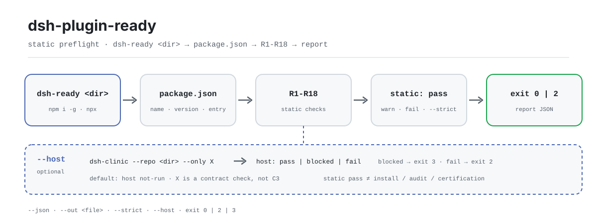

<div align="center">

<picture>
  <source media="(prefers-color-scheme: dark)" srcset="docs/assets/dsh-plugin-ready-flow-dark.svg">
  
</picture>

# dsh-plugin-ready

**Validate the package before you install the plugin: one command sweeps the static entry surface of package.json and returns a human- or machine-readable pass / fail report.**

`dsh-ready` is a zero-dependency CLI for DeepSeek Harness plugin authors. It inspects metadata, the entry point, `dsh.bundle` and its patch, `dsh.client`, `engines`, `manifestVersion`, README/LICENSE presence, and forbidden fields. It does not install the plugin and does not start a host.

[Install](#three-step-setup) · [Configuration](#configuration) · [FAQ](#faq) · [简体中文](README.md) · [English](README.en.md) · [Español](README.es.md) · [Português](README.pt.md) · [हिन्दी](README.hi.md)

[](LICENSE)
[](https://www.npmjs.com/package/dsh-plugin-ready)
[](https://github.com/PerryLink/dsh-plugin-ready/actions/workflows/test.yml)
[](https://nodejs.org/)

[](https://github.com/PerryLink/dsh-plugin-ready/stargazers)
[](https://www.npmjs.com/package/dsh-plugin-ready)
[](https://gitee.com/perrylink/dsh-plugin-ready)

```sh
# global install: the npm package is dsh-plugin-ready, the command is dsh-ready
npm i -g dsh-plugin-ready
dsh-ready .

# or run the same entry point without installing
npx dsh-plugin-ready .
```

</div>

<sub>Community tool, not affiliated with DeepSeek. Canonical repository: <https://github.com/PerryLink/dsh-plugin-ready> (Gitee is a mirror). No score, ranking, certification, or endorsement.</sub>

## What it is

`dsh-ready` breaks the question "will the host recognize this plugin package?" into 18 static checks against the target directory's `package.json`, patch file, and README/LICENSE. By default it only reports and never edits anything. Add `--json` for a machine-readable report with `schema`, `checks`, and `notClaimed`; add `--strict` to turn warnings into failures, which makes it usable as a CI gate.

It deliberately stays in its lane: it does not install the plugin, start DeepSeek Harness, benchmark performance, audit security, or certify anything. When you need real host-install evidence, run `dsh-dev test` or `dsh-test-drive` and feed the evidence to `entry-validate --host-evidence`. `--host` only invokes `dsh-clinic --only X` as a contract check, and its output says plainly that this is not C3.

The package name and the command name differ: the npm package is `dsh-plugin-ready`, and the executable is `dsh-ready` (see `package.json#bin`). There is no build step — `bin/` and `src/` are the shipped artifacts.

## Three-step setup

1. **Install** (Node >= 24.9.0; zero runtime dependencies):

   ```sh
   npm i -g dsh-plugin-ready   # global install provides dsh-ready
   dsh-ready --version

   npx dsh-plugin-ready --version   # no install needed
   ```

2. **Quick usage** (the current directory is the default target):

   ```sh
   dsh-ready                          # human-readable report
   dsh-ready ./my-plugin --json       # machine-readable JSON
   dsh-ready ./my-plugin --json --out ready-report.json
   dsh-ready ./my-plugin --strict     # warnings fail too
   dsh-ready ./my-plugin --host       # add dsh-clinic X (not C3)
   ```

3. **Verify the result and exit code**:

   ```text
   $ dsh-ready ./my-plugin
   dsh-ready 0.2.3
   target: /path/to/my-plugin
   R1 PASS package.json exists and is valid JSON
   ...
   static: pass-with-warnings (16 pass, 1 warn, 0 fail)
   host: not-run (static preflight only; ...)
   ```

   Excerpt; use `--json` for every field. `host` defaults to `not-run`, so a static pass never pretends the host ran. `$?`: `0` = pass or pass-with-warnings; `2` = any failure, a warning promoted by `--strict`, or a failed `--host`; `3` = the static layer would have returned `0` but `--host` is blocked.

   *Observed from `src/ready.js:194-231`; sample taken from a valid fixture with 16 pass / 1 warn.*

**Uninstall**: `npm uninstall -g dsh-plugin-ready` (`npx` uses a temporary install, so there is nothing to remove).

## Core capabilities

- **18 static entry checks** — from `name` / `version` / `description`, through `exports["."]`, `dsh.bundle` and its patch file, the `dsh.client` / `exports["./client"]` pairing, `engines` / `manifestVersion`, README/LICENSE presence, and forbidden `dsh.grade` / `score` / `rank` / `level` fields. Any failure fails the run; warnings do not block by default.
- **Human and machine output** — the default prints one `R<n> PASS|WARN|FAIL` line per check plus details; `--json` emits a fixed `schema: "dsh-plugin-ready/1"` report with per-check `checks`, a `static` summary, and a `notClaimed` array.
- **CI-gate friendly** — three exit codes only: `0` / `2` / `3`. `--strict` promotes warnings to `2`, and `--out` persists a JSON artifact alongside stdout.
- **Optional host contract check** — `--host` runs an installed `dsh-clinic --only X` and distinguishes `pass` / `blocked` / `fail`. Blocked is explicitly not a pass (exit `3`), and the tool never installs clinic for you.
- **Read-only and dependency-free** — imports Node built-ins only. Apart from the file named by `--out`, it writes nothing and never touches the target `package.json`.
- **Honest scope** — `notClaimed` always lists four disclaimers: not a host install, not a security audit, not a performance measurement, not a certification or official endorsement.

```text
dsh-ready <dir> ──▶ package.json ──▶ R1–R18 ──▶ static: pass | fail ──▶ exit 0 / 2
                                        └── --host ──▶ dsh-clinic X ──▶ pass | blocked | fail
```

## Configuration

`dsh-ready` has no config file, no environment variables, and no hidden global state; behavior is determined solely by the CLI arguments and the target directory. The most common options:

| Option | Default | Meaning |
|---|---|---|
| `<dir>` | `.` | Target plugin package directory, resolved to an absolute path with `path.resolve` |
| `--json` | off | Print the machine-readable JSON report to stdout |
| `--out <file>` | unset | Write the JSON report to a file; stdout still prints when combined with `--json` |
| `--strict` | off | Turn any warning into a failure (exit 2) |
| `--host` | off | Add the `dsh-clinic --only X` host contract check (not C3) |
| `-h` / `--help` | — | Print usage and exit 0 |
| `-v` / `--version` | — | Print the version only |

<details>
<summary>Full check list (R1–R18), exit codes, and report fields</summary>

### Checks

| ID | Failure level | What it checks |
|---|---|---|
| R1 | fail | `package.json` exists and is valid JSON |
| R2 | fail | `name` is a non-empty string |
| R3 | fail | `version` is valid semver |
| R4 | warn | `description` is non-empty |
| R5 | warn | `license` is non-empty (legal profile, not an entry hard failure) |
| R6 | fail | At least one entry point via `exports["."]` or `main` |
| R7 | fail | `dsh.bundle` is an object (a client-only package is not installable) |
| R8 | fail/warn | `dsh.bundle.patch` is a string or string array, the file exists, and it is not an empty insert |
| R9 | fail/warn | With `dsh.client` declared, `exports["./client"]` must exist and its target file must exist; a missing `platform` is only a warning |
| R10 | warn | `engines.dsh` exists (compatibility profile) |
| R11 | warn | `engines.node` exists |
| R12 | warn | `dsh.manifestVersion` is `1` |
| R13 | warn | `repository` exists |
| R14 | warn | `README.md` exists |
| R15 | warn | `LICENSE` exists |
| R16 | fail | `dsh.grade` / `dsh.score` / `dsh.rank` / `dsh.level` are forbidden |
| R17 | warn | If `dsh.standards.entry.status` claims a non-`not-run` status, warn without verifying it |
| R18 | warn/pass | Warn when `engines.dsh` and `peerDependencies["@deepseek-ai/dsh"]` disagree; pass when either carrier exists |

### Exit codes

| Code | When |
|---|---|
| `0` | The static layer is pass or pass-with-warnings, and neither `--strict` nor `--host` upgraded it |
| `2` | Any failure; a warning under `--strict`; or a failed `--host` |
| `3` | The static layer would have returned `0`, but `--host` is blocked (clinic missing, or the X group did not run fully) |

### Report fields

| Field | Meaning |
|---|---|
| `schema` | Always `dsh-plugin-ready/1` |
| `tool` / `version` | Tool name and the version that produced this run |
| `generatedAt` | ISO timestamp; changes on every run |
| `target` | Resolved absolute target path |
| `package` | Target `name` / `version`; `null` when `package.json` is unreadable |
| `static.status` | `pass` / `pass-with-warnings` / `fail` |
| `static.checks[]` | One `{ id, status, detail }` per evaluated check |
| `host.status` | `not-run` by default; `pass` / `blocked` / `fail` after `--host` |
| `host.reason` | Human-readable reason; `--host` runs also carry `command` / `groups` |
| `notClaimed[]` | The fixed four disclaimers |

</details>

## FAQ

<details>
<summary>How does this relate to actually installing a plugin?</summary>

It does not. This tool does not install anything, does not parse the profile patch, and does not start DSH; it only reads static files in the target directory. Installing plugins is the host's job, and this tool neither performs nor replaces it. For real host-install evidence, run `dsh-dev test` or `dsh-test-drive` and hand the result to `entry-validate --host-evidence`.

</details>

<details>
<summary>Why is --host blocked, and why exit code 3?</summary>

Two common causes: `dsh-clinic` is not on PATH (the report suggests `npm i -g dsh-clinic`), or the X group did not run fully or produced no JSON. Blocked is explicitly not a pass, so it gets its own exit code `3`. The tool never installs clinic automatically.

</details>

<details>
<summary>Does a static pass mean the package can ship, be listed, or is officially recognized?</summary>

No. The tool does not score, rank, or certify, and `notClaimed` always states the four things it does not claim. It answers one question only: is the static entry surface that a host reads first complete? Security, performance, runtime behavior, and license compliance are outside its measurement scope.

</details>

<details>
<summary>Will it modify my package.json or fix issues for me?</summary>

No. The whole check is read-only; the only write is the report file named by `--out`. There is no `--fix`, no `init`, no suggested patch, and no change to any file in the target package.

</details>

<details>
<summary>Why does running it on this repository itself produce R7 FAIL?</summary>

Because this repository is a CLI package, not a DSH plugin, and therefore has no `dsh.bundle`. R7 only makes sense for plugin packages — that is exactly the tool's boundary: it checks what "installing a plugin package" needs, not general npm package hygiene.

</details>

<details>
<summary>Can the report be used directly for snapshot tests?</summary>

`generatedAt` differs on every run, so strip it before byte-for-byte comparison. The `checks` order may also change between versions; compare by building a map keyed on `id`, not by array index.

</details>

## Known limitations

- **Static preflight only.** It does not install the plugin, start a host, or execute plugin code; `host` defaults to `not-run`.
- **`--host` depends on an external clinic.** Without `dsh-clinic`, or when the X group does not run fully, the result is `blocked` (exit 3). Blocked is not a pass, and the tool will not install clinic for you.
- **`--host` is not C3.** X is a host contract check. C3 requires real host-install evidence from `dsh-dev test` / `dsh-test-drive`, fed to `entry-validate --host-evidence`.
- **A static pass is not an audit, certification, or score.** Runtime behavior, security, performance, and license compliance are not checked; `notClaimed` states these disclaimers explicitly.
- **R17 reports without verifying.** If `dsh.standards.entry.status` claims a status, the tool does not confirm it is true.
- **DSH plugin packages only.** A plain npm package with no `dsh.bundle` fails R7; this repository is exactly such a CLI package, so that failure is expected.
- **Read-only, no repair.** There is no `--fix`, no suggested patch, and no rewrite of the target `package.json`.
- **The report is not byte-stable.** `generatedAt` changes every run; freeze the clock or remove the field before snapshot comparison.

## Development

```sh
npm install                          # no runtime deps; Node >= 24.9.0
npm test                             # node --test test/*.test.js
node bin/dsh-ready.js . --json       # run this repo's CLI directly
python scripts/gen-readme-assets.py  # regenerate both hero SVGs (Python + Pillow)
```

| Path | Purpose |
|---|---|
| `bin/dsh-ready.js` | CLI entry; forwards arguments to `main()` in `src/ready.js` |
| `src/ready.js` | `parse` / `check` / `report` / `runHost` / `main`; all of R1–R18 lives here |
| `test/ready.test.js` | Static-check, `--strict`, and R18 cases |
| `test/host.test.js` | `--host` cases against a fake `dsh-clinic` |
| `scripts/gen-readme-assets.py` | Generates the light/dark hero SVGs; repeatable |
| `docs/assets/` | Output: `dsh-plugin-ready-flow-{light,dark}.svg` |
| `.github/workflows/test.yml` | Runs `npm test` on push / PR (Node 20 / 24 matrix) |
| `.github/workflows/release.yml` | Manual trigger; `npm publish --provenance` |

The tests build the entry path with `new URL(...).pathname` and fake a POSIX `dsh-clinic` script, so `npm test` fails on a local Windows shell; CI runs on `ubuntu-latest`.

## Family and acknowledgments

This project is a member of the [PerryLink](https://github.com/PerryLink) family of DeepSeek Harness tools (all Apache-2.0). Sibling tools include [dsh-mask](https://github.com/PerryLink/dsh-mask) (PII masking at the model boundary) and [dsh-test-drive](https://github.com/PerryLink/dsh-test-drive) (real host-install evidence).

If this tool saves you a round of install debugging, **give it a star** — it does not unlock anything, but it helps the next plugin author find it.

- [@PerryLink](https://github.com/PerryLink) — creator and maintainer: the R1–R18 check matrix, the `--host` contract bridge, and the five-language docs.
- [dsh-clinic](https://www.npmjs.com/package/dsh-clinic) — the host contract checker invoked by `--host`.
- [dsh-test-drive](https://github.com/PerryLink/dsh-test-drive) / `dsh-dev test` — where real host-install evidence comes from.

## License

[LICENSE](LICENSE) (Apache License 2.0) © 2026 dsh-plugin-ready contributors

<p align="center"><sub>Apache-2.0 · community command-line tool, not affiliated with DeepSeek.</sub></p>
