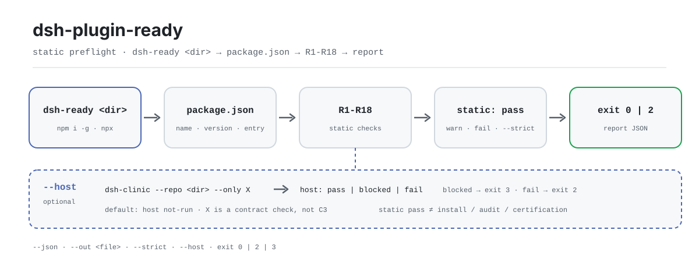

<div align="center">

<picture>
  <source media="(prefers-color-scheme: dark)" srcset="docs/assets/dsh-plugin-ready-flow-dark.svg">
  
</picture>

# dsh-plugin-ready

**Valida el paquete antes de instalar el plugin: un solo comando recorre la superficie de entrada estática de package.json y devuelve un informe pass / fail para personas o para máquinas.**

`dsh-ready` es una CLI sin dependencias para autores de plugins de DeepSeek Harness. Revisa metadatos, punto de entrada, `dsh.bundle` y su patch, `dsh.client`, `engines`, `manifestVersion`, la presencia de README/LICENSE y los campos prohibidos. No instala el plugin ni arranca un host.

[Instalación](#instalación-en-tres-pasos) · [Configuración](#configuración) · [FAQ](#faq) · [简体中文](README.md) · [English](README.en.md) · [Español](README.es.md) · [Português](README.pt.md) · [हिन्दी](README.hi.md)

[](LICENSE)
[](https://www.npmjs.com/package/dsh-plugin-ready)
[](https://github.com/PerryLink/dsh-plugin-ready/actions/workflows/test.yml)
[](https://nodejs.org/)

[](https://github.com/PerryLink/dsh-plugin-ready/stargazers)
[](https://www.npmjs.com/package/dsh-plugin-ready)
[](https://gitee.com/perrylink/dsh-plugin-ready)

```sh
# instalación global: el paquete npm es dsh-plugin-ready y el comando es dsh-ready
npm i -g dsh-plugin-ready
dsh-ready .

# o ejecuta el mismo punto de entrada sin instalar
npx dsh-plugin-ready .
```

</div>

<sub>Herramienta comunitaria, sin relación con DeepSeek. Repositorio canónico: <https://github.com/PerryLink/dsh-plugin-ready> (Gitee es un espejo). Sin puntuación, ranking, certificación ni respaldo.</sub>

## Qué es

`dsh-ready` descompone la pregunta «¿el host va a reconocer este paquete de plugin?» en 18 comprobaciones estáticas sobre el `package.json` del directorio objetivo, el archivo patch y la presencia de README/LICENSE. Por defecto solo informa y nunca edita nada. Con `--json` obtienes un informe legible por máquina con `schema`, `checks` y `notClaimed`; con `--strict` las advertencias también fallan, lo que lo hace apto como puerta de CI.

Se mantiene deliberadamente dentro de su alcance: no instala el plugin, no arranca DeepSeek Harness, no mide rendimiento, no audita seguridad ni certifica nada. Cuando necesites evidencia real de instalación en un host, ejecuta `dsh-dev test` o `dsh-test-drive` y entrega la evidencia a `entry-validate --host-evidence`. `--host` solo invoca `dsh-clinic --only X` como comprobación de contrato, y su salida dice claramente que no es C3.

El nombre del paquete y el del comando difieren: el paquete npm es `dsh-plugin-ready` y el ejecutable es `dsh-ready` (ver `package.json#bin`). No hay paso de build: `bin/` y `src/` son los artefactos publicados.

## Instalación en tres pasos

1. **Instalar** (Node >= 24.9.0; sin dependencias en tiempo de ejecución):

   ```sh
   npm i -g dsh-plugin-ready   # la instalación global añade dsh-ready
   dsh-ready --version

   npx dsh-plugin-ready --version   # sin instalar
   ```

2. **Uso rápido** (el directorio actual es el objetivo por defecto):

   ```sh
   dsh-ready                          # informe legible
   dsh-ready ./my-plugin --json       # JSON para máquinas
   dsh-ready ./my-plugin --json --out ready-report.json
   dsh-ready ./my-plugin --strict     # las advertencias también fallan
   dsh-ready ./my-plugin --host       # añade dsh-clinic X (no C3)
   ```

3. **Verificar el resultado y el código de salida**:

   ```text
   $ dsh-ready ./my-plugin
   dsh-ready 0.2.3
   target: /path/to/my-plugin
   R1 PASS package.json exists and is valid JSON
   ...
   static: pass-with-warnings (16 pass, 1 warn, 0 fail)
   host: not-run (static preflight only; ...)
   ```

   Extracto; usa `--json` para ver todos los campos. `host` vale `not-run` por defecto, así que un pass estático nunca finge que el host se ejecutó. `$?`: `0` = pass o pass-with-warnings; `2` = algún fallo, una advertencia promovida por `--strict` o un `--host` fallido; `3` = la capa estática habría devuelto `0`, pero `--host` está bloqueado.

   *Observed from `src/ready.js:194-231`; muestra tomada de un fixture válido con 16 pass / 1 warn.*

**Desinstalar**: `npm uninstall -g dsh-plugin-ready` (con `npx` la instalación es temporal y no hay nada que quitar).

## Capacidades principales

- **18 comprobaciones estáticas de entrada** — desde `name` / `version` / `description`, pasando por `exports["."]`, `dsh.bundle` y su patch, el emparejamiento `dsh.client` / `exports["./client"]`, `engines` / `manifestVersion`, la presencia de README/LICENSE y los campos prohibidos `dsh.grade` / `score` / `rank` / `level`. Cualquier fallo hace fallar la ejecución; las advertencias no bloquean por defecto.
- **Salida para personas y para máquinas** — por defecto imprime una línea `R<n> PASS|WARN|FAIL` por comprobación con su detalle; `--json` emite un informe con `schema: "dsh-plugin-ready/1"`, `checks` por elemento, resumen `static` y el arreglo `notClaimed`.
- **Compatible con puertas de CI** — solo tres códigos de salida: `0` / `2` / `3`. `--strict` convierte advertencias en `2` y `--out` guarda un artefacto JSON además de stdout.
- **Comprobación opcional de contrato de host** — `--host` ejecuta el `dsh-clinic --only X` instalado y distingue `pass` / `blocked` / `fail`. Blocked no es un pass (código `3`) y la herramienta nunca instala clinic por ti.
- **Solo lectura y sin dependencias** — solo importa módulos internos de Node. Aparte del archivo indicado por `--out`, no escribe nada y nunca toca el `package.json` objetivo.
- **Alcance honesto** — `notClaimed` siempre enumera cuatro renuncias: no es instalación en host, no es auditoría de seguridad, no es medición de rendimiento, no es certificación ni respaldo oficial.

```text
dsh-ready <dir> ──▶ package.json ──▶ R1–R18 ──▶ static: pass | fail ──▶ exit 0 / 2
                                        └── --host ──▶ dsh-clinic X ──▶ pass | blocked | fail
```

## Configuración

`dsh-ready` no tiene archivo de configuración, variables de entorno ni estado global oculto; el comportamiento depende solo de los argumentos de la CLI y del directorio objetivo. Las opciones más usadas:

| Opción | Por defecto | Significado |
|---|---|---|
| `<dir>` | `.` | Directorio del paquete objetivo, resuelto a ruta absoluta con `path.resolve` |
| `--json` | off | Imprime el informe JSON legible por máquina en stdout |
| `--out <file>` | sin definir | Escribe el informe JSON en un archivo; con `--json` stdout sigue imprimiendo |
| `--strict` | off | Convierte cualquier advertencia en fallo (exit 2) |
| `--host` | off | Añade la comprobación de contrato `dsh-clinic --only X` (no C3) |
| `-h` / `--help` | — | Imprime el uso y sale con 0 |
| `-v` / `--version` | — | Imprime solo la versión |

<details>
<summary>Lista completa de comprobaciones (R1–R18), códigos de salida y campos del informe</summary>

### Comprobaciones

| ID | Nivel de fallo | Qué comprueba |
|---|---|---|
| R1 | fail | `package.json` existe y es JSON válido |
| R2 | fail | `name` es una cadena no vacía |
| R3 | fail | `version` es semver válido |
| R4 | warn | `description` no está vacío |
| R5 | warn | `license` no está vacío (perfil legal, no fallo duro de entrada) |
| R6 | fail | Al menos un punto de entrada vía `exports["."]` o `main` |
| R7 | fail | `dsh.bundle` es un objeto (un paquete solo-cliente no es instalable) |
| R8 | fail/warn | `dsh.bundle.patch` es cadena o arreglo de cadenas, el archivo existe y no es un insert vacío |
| R9 | fail/warn | Con `dsh.client` declarado, `exports["./client"]` debe existir y su archivo destino debe existir; falta de `platform` solo es advertencia |
| R10 | warn | `engines.dsh` existe (perfil de compatibilidad) |
| R11 | warn | `engines.node` existe |
| R12 | warn | `dsh.manifestVersion` es `1` |
| R13 | warn | `repository` existe |
| R14 | warn | `README.md` existe |
| R15 | warn | `LICENSE` existe |
| R16 | fail | `dsh.grade` / `dsh.score` / `dsh.rank` / `dsh.level` están prohibidos |
| R17 | warn | Si `dsh.standards.entry.status` declara un estado distinto de `not-run`, avisa sin verificarlo |
| R18 | warn/pass | Avisa si `engines.dsh` y `peerDependencies["@deepseek-ai/dsh"]` no coinciden; pasa si existe cualquiera de los dos |

### Códigos de salida

| Código | Cuándo |
|---|---|
| `0` | La capa estática es pass o pass-with-warnings y ni `--strict` ni `--host` la elevaron |
| `2` | Algún fallo; una advertencia con `--strict`; o un `--host` fallido |
| `3` | La capa estática habría devuelto `0`, pero `--host` está bloqueado (clinic no instalado o el grupo X no se ejecutó completo) |

### Campos del informe

| Campo | Significado |
|---|---|
| `schema` | Siempre `dsh-plugin-ready/1` |
| `tool` / `version` | Nombre de la herramienta y versión que produjo la ejecución |
| `generatedAt` | Marca temporal ISO; cambia en cada ejecución |
| `target` | Ruta absoluta resuelta del objetivo |
| `package` | `name` / `version` del objetivo; `null` si `package.json` no se puede leer |
| `static.status` | `pass` / `pass-with-warnings` / `fail` |
| `static.checks[]` | Un `{ id, status, detail }` por comprobación evaluada |
| `host.status` | `not-run` por defecto; `pass` / `blocked` / `fail` tras `--host` |
| `host.reason` | Razón legible; las ejecuciones con `--host` también traen `command` / `groups` |
| `notClaimed[]` | Las cuatro renuncias fijas |

</details>

## FAQ

<details>
<summary>¿Qué relación tiene con la instalación real de un plugin?</summary>

Ninguna. Esta herramienta no instala nada, no interpreta el patch del perfil y no arranca DSH; solo lee archivos estáticos del directorio objetivo. Instalar plugins es tarea del host, y esta herramienta ni lo hace ni lo sustituye. Para evidencia real de instalación en host, ejecuta `dsh-dev test` o `dsh-test-drive` y entrega el resultado a `entry-validate --host-evidence`.

</details>

<details>
<summary>¿Por qué --host aparece bloqueado y con código de salida 3?</summary>

Dos causas habituales: `dsh-clinic` no está en el PATH (el informe sugiere `npm i -g dsh-clinic`), o el grupo X no se ejecutó completo o no produjo JSON. Blocked no es un pass, por eso tiene su propio código `3`. La herramienta nunca instala clinic automáticamente.

</details>

<details>
<summary>¿Un pass estático significa que el paquete puede publicarse, listarse o está reconocido oficialmente?</summary>

No. La herramienta no puntúa, no hace ranking ni certifica, y `notClaimed` declara siempre las cuatro cosas que no afirma. Solo responde una pregunta: ¿está completa la superficie de entrada estática que el host lee primero? Seguridad, rendimiento, comportamiento en ejecución y cumplimiento de licencias quedan fuera de su alcance.

</details>

<details>
<summary>¿Va a modificar mi package.json o a arreglar los problemas por mí?</summary>

No. Toda la comprobación es de solo lectura; la única escritura es el archivo de informe indicado por `--out`. No hay `--fix`, ni `init`, ni parche sugerido, ni cambios en ningún archivo del paquete objetivo.

</details>

<details>
<summary>¿Por qué al ejecutarlo sobre este mismo repositorio da R7 FAIL?</summary>

Porque este repositorio es un paquete CLI, no un plugin de DSH, y por tanto no tiene `dsh.bundle`. R7 solo tiene sentido para paquetes de plugin: ese es justamente el límite de la herramienta, que comprueba lo necesario para «instalar un paquete de plugin», no la higiene general de un paquete npm.

</details>

<details>
<summary>¿Se puede usar el informe directamente en pruebas de snapshot?</summary>

`generatedAt` cambia en cada ejecución, así que elimínalo antes de comparar byte a byte. El orden de `checks` también puede cambiar entre versiones; compara con un mapa indexado por `id`, no por posición en el arreglo.

</details>

## Limitaciones conocidas

- **Solo preflight estático.** No instala el plugin, no arranca un host ni ejecuta código del plugin; `host` vale `not-run` por defecto.
- **`--host` depende de un clinic externo.** Sin `dsh-clinic`, o si el grupo X no se ejecuta completo, el resultado es `blocked` (exit 3). Blocked no es un pass y la herramienta no instala clinic por ti.
- **`--host` no es C3.** X es una comprobación de contrato de host. C3 requiere evidencia real de instalación en host con `dsh-dev test` / `dsh-test-drive`, entregada a `entry-validate --host-evidence`.
- **Un pass estático no es auditoría, certificación ni puntuación.** No se comprueban comportamiento en ejecución, seguridad, rendimiento ni cumplimiento de licencias; `notClaimed` lo declara explícitamente.
- **R17 informa sin verificar.** Si `dsh.standards.entry.status` declara un estado, la herramienta no confirma que sea cierto.
- **Solo paquetes de plugin de DSH.** Un paquete npm normal sin `dsh.bundle` falla R7; este repositorio es exactamente un paquete CLI así, de modo que ese fallo es esperado.
- **Solo lectura, sin reparación.** No hay `--fix`, ni parche sugerido, ni reescritura del `package.json` objetivo.
- **El informe no es estable byte a byte.** `generatedAt` cambia en cada ejecución; congela el reloj o elimina el campo antes de comparar snapshots.

## Desarrollo

```sh
npm install                          # sin dependencias de ejecución; Node >= 24.9.0
npm test                             # node --test test/*.test.js
node bin/dsh-ready.js . --json       # ejecutar la CLI de este repositorio
python scripts/gen-readme-assets.py  # regenerar los dos SVG hero (Python + Pillow)
```

| Ruta | Propósito |
|---|---|
| `bin/dsh-ready.js` | Entrada de la CLI; pasa los argumentos a `main()` en `src/ready.js` |
| `src/ready.js` | `parse` / `check` / `report` / `runHost` / `main`; aquí viven R1–R18 |
| `test/ready.test.js` | Casos de comprobación estática, `--strict` y R18 |
| `test/host.test.js` | Casos de `--host` contra un `dsh-clinic` falso |
| `scripts/gen-readme-assets.py` | Genera los SVG hero claro/oscuro; repetible |
| `docs/assets/` | Salida: `dsh-plugin-ready-flow-{light,dark}.svg` |
| `.github/workflows/test.yml` | Ejecuta `npm test` en push / PR (matriz Node 20 / 24) |
| `.github/workflows/release.yml` | Disparo manual; `npm publish --provenance` |

Los tests construyen la ruta de entrada con `new URL(...).pathname` y simulan un script `dsh-clinic` POSIX, así que `npm test` falla en una shell Windows local; la CI se ejecuta en `ubuntu-latest`.

## Familia y agradecimientos

Este proyecto es miembro de la familia de herramientas de DeepSeek Harness mantenida por [PerryLink](https://github.com/PerryLink) (todas Apache-2.0). Entre las herramientas hermanas están [dsh-mask](https://github.com/PerryLink/dsh-mask) (enmascarado de PII en el límite del modelo) y [dsh-test-drive](https://github.com/PerryLink/dsh-test-drive) (evidencia real de instalación en host).

Si esta herramienta te ahorra una ronda de depuración al instalar, **dale una estrella**: no desbloquea nada, pero ayuda a que el siguiente autor de plugins la encuentre.

- [@PerryLink](https://github.com/PerryLink) — creador y mantenedor: la matriz de comprobaciones R1–R18, el puente de contrato `--host` y la documentación en cinco idiomas.
- [dsh-clinic](https://www.npmjs.com/package/dsh-clinic) — el comprobador de contrato de host que invoca `--host`.
- [dsh-test-drive](https://github.com/PerryLink/dsh-test-drive) / `dsh-dev test` — de dónde sale la evidencia real de instalación en host.

## Licencia

[LICENSE](LICENSE) (Apache License 2.0) © 2026 dsh-plugin-ready contributors

<p align="center"><sub>Apache-2.0 · herramienta de línea de comandos comunitaria, sin relación con DeepSeek.</sub></p>
