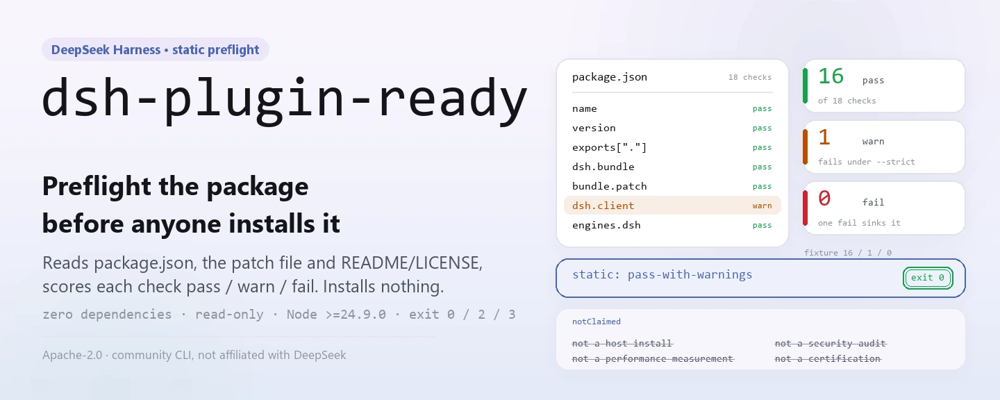
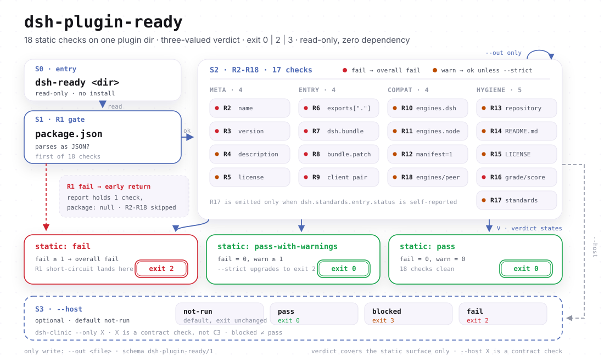

<div align="center">

<picture>
  <source media="(prefers-color-scheme: dark)" srcset="docs/assets/dsh-plugin-ready-hero-en-dark.webp">
  
</picture>

# dsh-plugin-ready

**प्लगइन इंस्टॉल करने से पहले पैकेज जाँचें: एक कमांड package.json की स्टैटिक एंट्री सतह को स्कैन करके इंसान या मशीन के लिए pass / fail रिपोर्ट देता है।**

`dsh-ready` DeepSeek Harness प्लगइन लेखकों के लिए शून्य-निर्भरता CLI है। यह मेटाडेटा, एंट्री पॉइंट, `dsh.bundle` और उसका patch, `dsh.client`, `engines`, `manifestVersion`, README/LICENSE की मौजूदगी और वर्जित फ़ील्ड जाँचता है। यह प्लगइन इंस्टॉल नहीं करता और होस्ट शुरू नहीं करता।

[इंस्टॉल](#तीन-चरणों-में-शुरुआत) · [कॉन्फ़िगरेशन](#कॉन्फ़िगरेशन) · [FAQ](#faq) · [简体中文](README.md) · [English](README.en.md) · [Español](README.es.md) · [Português](README.pt.md) · [हिन्दी](README.hi.md)

[](LICENSE)
[](https://www.npmjs.com/package/dsh-plugin-ready)
[](https://github.com/PerryLink/dsh-plugin-ready/actions/workflows/test.yml)
[](https://nodejs.org/)

[](https://github.com/PerryLink/dsh-plugin-ready/stargazers)
[](https://www.npmjs.com/package/dsh-plugin-ready)
[](https://gitee.com/perrylink/dsh-plugin-ready)

```sh
# ग्लोबल इंस्टॉल: npm पैकेज dsh-plugin-ready है, और कमांड dsh-ready है
npm i -g dsh-plugin-ready
dsh-ready .

# या बिना इंस्टॉल किए वही एंट्री पॉइंट चलाएँ
npx dsh-plugin-ready .
```

</div>

<sub>सामुदायिक टूल, DeepSeek से संबद्ध नहीं। आधिकारिक रेपो: <https://github.com/PerryLink/dsh-plugin-ready> (Gitee मिरर है)। कोई स्कोर, रैंकिंग, प्रमाणन या अनुमोदन नहीं।</sub>

## यह क्या है

`dsh-ready` इस सवाल को 18 स्टैटिक जाँचों में तोड़ता है — «क्या होस्ट इस प्लगइन पैकेज को पहचान पाएगा?»। जाँचें लक्ष्य डायरेक्टरी के `package.json`, patch फ़ाइल और README/LICENSE की मौजूदगी पर चलती हैं। डिफ़ॉल्ट रूप से यह सिर्फ़ रिपोर्ट करता है और कोई फ़ाइल नहीं बदलता। `--json` जोड़ने पर `schema`, `checks` और `notClaimed` वाली मशीन-पठनीय रिपोर्ट मिलती है; `--strict` जोड़ने पर चेतावनियाँ भी विफल होती हैं, इसलिए इसे CI गेट की तरह इस्तेमाल किया जा सकता है।

यह जानबूझकर अपनी सीमा में रहता है: प्लगइन इंस्टॉल नहीं करता, DeepSeek Harness शुरू नहीं करता, परफ़ॉर्मेंस नहीं मापता, सुरक्षा ऑडिट नहीं करता और किसी चीज़ का प्रमाणन नहीं करता। जब असली होस्ट-इंस्टॉल सबूत चाहिए, तो `dsh-dev test` या `dsh-test-drive` चलाएँ और सबूत `entry-validate --host-evidence` को दें। `--host` सिर्फ़ `dsh-clinic --only X` को कॉन्ट्रैक्ट जाँच के रूप में चलाता है, और उसका आउटपुट साफ़ कहता है कि यह C3 नहीं है।

पैकेज का नाम और कमांड का नाम अलग हैं: npm पैकेज `dsh-plugin-ready` है और executable `dsh-ready` (देखें `package.json#bin`)। कोई build चरण नहीं है — `bin/` और `src/` ही प्रकाशित आर्टिफ़ैक्ट हैं।

<picture>
  <source media="(prefers-color-scheme: dark)" srcset="docs/assets/dsh-plugin-ready-flow-v5-dark.svg">
  
</picture>

## तीन चरणों में शुरुआत

1. **इंस्टॉल करें** (Node >= 24.9.0; कोई रनटाइम निर्भरता नहीं):

   ```sh
   npm i -g dsh-plugin-ready   # ग्लोबल इंस्टॉल dsh-ready देता है
   dsh-ready --version

   npx dsh-plugin-ready --version   # बिना इंस्टॉल
   ```

2. **तेज़ उपयोग** (डिफ़ॉल्ट लक्ष्य मौजूदा डायरेक्टरी है):

   ```sh
   dsh-ready                          # इंसान के लिए रिपोर्ट
   dsh-ready ./my-plugin --json       # मशीन के लिए JSON
   dsh-ready ./my-plugin --json --out ready-report.json
   dsh-ready ./my-plugin --strict     # चेतावनियाँ भी विफल
   dsh-ready ./my-plugin --host       # dsh-clinic X जोड़ें (C3 नहीं)
   ```

3. **नतीजा और exit कोड जाँचें**:

   ```text
   $ dsh-ready ./my-plugin
   dsh-ready 0.2.3
   target: /path/to/my-plugin
   R1 PASS package.json exists and is valid JSON
   ...
   static: pass-with-warnings (16 pass, 1 warn, 0 fail)
   host: not-run (static preflight only; ...)
   ```

   अंश; सभी फ़ील्ड के लिए `--json` देखें। `host` डिफ़ॉल्ट रूप से `not-run` रहता है, इसलिए स्टैटिक pass कभी यह नहीं दिखाता कि होस्ट चला। `$?`: `0` = pass या pass-with-warnings; `2` = कोई विफलता, `--strict` से बढ़ाई गई चेतावनी, या विफल `--host`; `3` = स्टैटिक परत `0` देती, पर `--host` blocked है।

   *Observed from `src/ready.js:194-231`; नमूना 16 pass / 1 warn वाले वैध fixture से लिया गया।*

**अनइंस्टॉल**: `npm uninstall -g dsh-plugin-ready` (`npx` में इंस्टॉल अस्थायी होता है, हटाने के लिए कुछ नहीं)।

## मुख्य क्षमताएँ

- **18 स्टैटिक एंट्री जाँचें** — `name` / `version` / `description` से लेकर `exports["."]`, `dsh.bundle` और उसका patch, `dsh.client` / `exports["./client"]` की जोड़ी, `engines` / `manifestVersion`, README/LICENSE की मौजूदगी और वर्जित `dsh.grade` / `score` / `rank` / `level` फ़ील्ड तक। कोई भी विफलता पूरी रन विफल करती है; चेतावनियाँ डिफ़ॉल्ट रूप से नहीं रोकतीं।
- **इंसान और मशीन, दोनों के लिए आउटपुट** — डिफ़ॉल्ट रूप से हर जाँच के लिए `R<n> PASS|WARN|FAIL` पंक्ति और विवरण; `--json` में `schema: "dsh-plugin-ready/1"`, प्रति-जाँच `checks`, `static` सारांश और `notClaimed` सरणी मिलती है।
- **CI गेट के अनुकूल** — सिर्फ़ तीन exit कोड: `0` / `2` / `3`। `--strict` चेतावनियों को `2` बनाता है, और `--out` stdout के साथ एक JSON आर्टिफ़ैक्ट भी सहेजता है।
- **वैकल्पिक होस्ट कॉन्ट्रैक्ट जाँच** — `--host` इंस्टॉल किए गए `dsh-clinic --only X` को चलाता है और `pass` / `blocked` / `fail` में फ़र्क़ करता है। blocked स्पष्ट रूप से pass नहीं है (exit `3`), और टूल आपके लिए clinic इंस्टॉल नहीं करता।
- **केवल-पठन और शून्य निर्भरता** — सिर्फ़ Node के अंतर्निहित मॉड्यूल आयात करता है। `--out` वाली फ़ाइल के अलावा कुछ नहीं लिखता और लक्ष्य `package.json` को कभी नहीं छूता।
- **ईमानदार दायरा** — `notClaimed` हमेशा चार अस्वीकृतियाँ गिनाता है: होस्ट इंस्टॉल नहीं, सुरक्षा ऑडिट नहीं, परफ़ॉर्मेंस मापन नहीं, प्रमाणन या आधिकारिक अनुमोदन नहीं।

```text
dsh-ready <dir> ──▶ package.json ──▶ R1–R18 ──▶ static: pass | fail ──▶ exit 0 / 2
                                        └── --host ──▶ dsh-clinic X ──▶ pass | blocked | fail
```

## कॉन्फ़िगरेशन

`dsh-ready` में कोई कॉन्फ़िग फ़ाइल, environment variable या छिपी हुई ग्लोबल स्थिति नहीं है; व्यवहार सिर्फ़ CLI आर्ग्युमेंट और लक्ष्य डायरेक्टरी से तय होता है। सबसे अधिक इस्तेमाल होने वाले विकल्प:

| विकल्प | डिफ़ॉल्ट | अर्थ |
|---|---|---|
| `<dir>` | `.` | लक्ष्य प्लगइन पैकेज डायरेक्टरी, `path.resolve` से पूर्ण पथ |
| `--json` | बंद | मशीन-पठनीय JSON रिपोर्ट stdout पर |
| `--out <file>` | सेट नहीं | JSON रिपोर्ट फ़ाइल में लिखें; `--json` के साथ stdout भी छपता रहता है |
| `--strict` | बंद | किसी भी चेतावनी को विफलता बनाएँ (exit 2) |
| `--host` | बंद | `dsh-clinic --only X` होस्ट कॉन्ट्रैक्ट जाँच जोड़ें (C3 नहीं) |
| `-h` / `--help` | — | उपयोग छापें और 0 पर बाहर निकलें |
| `-v` / `--version` | — | सिर्फ़ संस्करण छापें |

<details>
<summary>पूरी जाँच सूची (R1–R18), exit कोड और रिपोर्ट फ़ील्ड</summary>

### जाँचें

| ID | विफलता स्तर | क्या जाँचता है |
|---|---|---|
| R1 | fail | `package.json` मौजूद है और वैध JSON है |
| R2 | fail | `name` खाली नहीं है |
| R3 | fail | `version` वैध semver है |
| R4 | warn | `description` खाली नहीं है |
| R5 | warn | `license` खाली नहीं है (लीगल प्रोफ़ाइल, एंट्री की कठोर विफलता नहीं) |
| R6 | fail | `exports["."]` या `main` से कम-से-कम एक एंट्री पॉइंट |
| R7 | fail | `dsh.bundle` ऑब्जेक्ट है (केवल-client पैकेज इंस्टॉल करने योग्य नहीं) |
| R8 | fail/warn | `dsh.bundle.patch` स्ट्रिंग या स्ट्रिंग सरणी है, फ़ाइल मौजूद है और खाली insert नहीं है |
| R9 | fail/warn | `dsh.client` घोषित होने पर `exports["./client"]` मौजूद हो और उसकी फ़ाइल हो; `platform` न होना सिर्फ़ चेतावनी है |
| R10 | warn | `engines.dsh` मौजूद है (संगतता प्रोफ़ाइल) |
| R11 | warn | `engines.node` मौजूद है |
| R12 | warn | `dsh.manifestVersion` `1` है |
| R13 | warn | `repository` मौजूद है |
| R14 | warn | `README.md` मौजूद है |
| R15 | warn | `LICENSE` मौजूद है |
| R16 | fail | `dsh.grade` / `dsh.score` / `dsh.rank` / `dsh.level` वर्जित हैं |
| R17 | warn | `dsh.standards.entry.status` अगर `not-run` से अलग स्थिति बताए, तो बिना सत्यापन चेतावनी |
| R18 | warn/pass | `engines.dsh` और `peerDependencies["@deepseek-ai/dsh"]` अलग हों तो चेतावनी; कोई एक वाहक हो तो pass |

### Exit कोड

| कोड | कब |
|---|---|
| `0` | स्टैटिक परत pass या pass-with-warnings है, और `--strict` / `--host` ने उसे नहीं बढ़ाया |
| `2` | कोई विफलता; `--strict` के तहत चेतावनी; या विफल `--host` |
| `3` | स्टैटिक परत `0` देती, पर `--host` blocked है (clinic नहीं है, या X समूह पूरा नहीं चला) |

### रिपोर्ट फ़ील्ड

| फ़ील्ड | अर्थ |
|---|---|
| `schema` | हमेशा `dsh-plugin-ready/1` |
| `tool` / `version` | टूल का नाम और इस रन का संस्करण |
| `generatedAt` | ISO टाइमस्टैंप; हर रन में बदलता है |
| `target` | लक्ष्य का हल किया गया पूर्ण पथ |
| `package` | लक्ष्य का `name` / `version`; `package.json` न पढ़े जाने पर `null` |
| `static.status` | `pass` / `pass-with-warnings` / `fail` |
| `static.checks[]` | हर जाँच के लिए `{ id, status, detail }` |
| `host.status` | डिफ़ॉल्ट `not-run`; `--host` के बाद `pass` / `blocked` / `fail` |
| `host.reason` | मानव-पठनीय कारण; `--host` रन में `command` / `groups` भी |
| `notClaimed[]` | चार निश्चित अस्वीकृतियाँ |

</details>

## FAQ

<details>
<summary>इसका असली प्लगइन इंस्टॉल से क्या संबंध है?</summary>

कोई नहीं। यह टूल कुछ इंस्टॉल नहीं करता, profile patch नहीं पढ़ता और DSH शुरू नहीं करता; यह सिर्फ़ लक्ष्य डायरेक्टरी की स्टैटिक फ़ाइलें पढ़ता है। प्लगइन इंस्टॉल करना होस्ट का काम है, और यह टूल न उसे करता है न उसकी जगह लेता है। असली होस्ट-इंस्टॉल सबूत के लिए `dsh-dev test` या `dsh-test-drive` चलाएँ और नतीजा `entry-validate --host-evidence` को दें।

</details>

<details>
<summary>--host blocked क्यों दिखता है और exit कोड 3 क्यों है?</summary>

दो आम कारण: `dsh-clinic` PATH में नहीं है (रिपोर्ट `npm i -g dsh-clinic` सुझाती है), या X समूह पूरा नहीं चला / JSON नहीं दिया। blocked स्पष्ट रूप से pass नहीं है, इसलिए उसके लिए अलग कोड `3` है। टूल clinic अपने आप इंस्टॉल नहीं करता।

</details>

<details>
<summary>क्या स्टैटिक pass का मतलब है कि पैकेज प्रकाशित/सूचीबद्ध या आधिकारिक रूप से मान्य है?</summary>

नहीं। टूल स्कोर, रैंकिंग या प्रमाणन नहीं करता, और `notClaimed` हमेशा वे चार बातें बताता है जिनका दावा नहीं है। यह सिर्फ़ एक सवाल का जवाब देता है: होस्ट सबसे पहले जो स्टैटिक एंट्री सतह पढ़ता है, वह पूरी है या नहीं? सुरक्षा, परफ़ॉर्मेंस, रनटाइम व्यवहार और लाइसेंस अनुपालन इसके दायरे से बाहर हैं।

</details>

<details>
<summary>क्या यह मेरा package.json बदलेगा या समस्याएँ ठीक कर देगा?</summary>

नहीं। पूरी जाँच केवल-पठन है; एकमात्र लेखन `--out` वाली रिपोर्ट फ़ाइल है। कोई `--fix` नहीं, कोई `init` नहीं, कोई सुझाया patch नहीं, और लक्ष्य पैकेज की किसी फ़ाइल में कोई बदलाव नहीं।

</details>

<details>
<summary>इसी रेपो पर चलाने से R7 FAIL क्यों आता है?</summary>

क्योंकि यह रेपो खुद एक CLI पैकेज है, DSH प्लगइन नहीं, इसलिए इसमें `dsh.bundle` नहीं है। R7 सिर्फ़ प्लगइन पैकेज के लिए अर्थ रखता है — यही टूल की सीमा है: यह «प्लगइन पैकेज इंस्टॉल करने» के लिए ज़रूरी चीज़ें जाँचता है, सामान्य npm पैकेज की स्वच्छता नहीं।

</details>

<details>
<summary>क्या रिपोर्ट सीधे snapshot टेस्ट में इस्तेमाल हो सकती है?</summary>

`generatedAt` हर रन में बदलता है, इसलिए byte-by-byte तुलना से पहले उसे हटाएँ। `checks` का क्रम भी संस्करणों के बीच बदल सकता है; सरणी सूचकांक के बजाय `id` पर बनी मैप से तुलना करें।

</details>

## ज्ञात सीमाएँ

- **सिर्फ़ स्टैटिक प्रीफ़्लाइट।** प्लगइन इंस्टॉल नहीं करता, होस्ट शुरू नहीं करता और प्लगइन कोड नहीं चलाता; `host` डिफ़ॉल्ट रूप से `not-run` है।
- **`--host` बाहरी clinic पर निर्भर है।** `dsh-clinic` न होने, या X समूह पूरा न चलने पर नतीजा `blocked` (exit 3) होता है। blocked pass नहीं है और टूल clinic अपने आप इंस्टॉल नहीं करता।
- **`--host` C3 नहीं है।** X होस्ट कॉन्ट्रैक्ट जाँच है। C3 के लिए `dsh-dev test` / `dsh-test-drive` से असली होस्ट-इंस्टॉल सबूत चाहिए, जो `entry-validate --host-evidence` को दिया जाए।
- **स्टैटिक pass ऑडिट, प्रमाणन या स्कोर नहीं है।** रनटाइम व्यवहार, सुरक्षा, परफ़ॉर्मेंस और लाइसेंस अनुपालन नहीं जाँचे जाते; `notClaimed` यह स्पष्ट कहता है।
- **R17 बिना सत्यापन बताता है।** अगर `dsh.standards.entry.status` कोई स्थिति बताता है, तो टूल उसकी सच्चाई नहीं जाँचता।
- **सिर्फ़ DSH प्लगइन पैकेज।** `dsh.bundle` न होने वाला सामान्य npm पैकेज R7 पर विफल होता है; यह रेपो खुद ऐसा CLI पैकेज है, इसलिए वह विफलता अपेक्षित है।
- **केवल-पठन, कोई मरम्मत नहीं।** `--fix` नहीं, सुझाया patch नहीं, लक्ष्य `package.json` का पुनर्लेखन नहीं।
- **रिपोर्ट byte-stable नहीं है।** `generatedAt` हर रन में बदलता है; snapshot तुलना से पहले घड़ी जमाएँ या फ़ील्ड हटाएँ।

## विकास

```sh
npm install                          # कोई रनटाइम निर्भरता नहीं; Node >= 24.9.0
npm test                             # node --test test/*.test.js
node bin/dsh-ready.js . --json       # इस रेपो की CLI सीधे चलाएँ
python scripts/gen-readme-assets.py  # hero WebP और flow SVG फिर बनाएँ (Python + Pillow)
```

| पथ | उद्देश्य |
|---|---|
| `bin/dsh-ready.js` | CLI एंट्री; आर्ग्युमेंट `src/ready.js` के `main()` को भेजता है |
| `src/ready.js` | `parse` / `check` / `report` / `runHost` / `main`; R1–R18 यहीं है |
| `test/ready.test.js` | स्टैटिक जाँच, `--strict` और R18 के केस |
| `test/host.test.js` | नकली `dsh-clinic` के साथ `--host` के केस |
| `scripts/gen-readme-assets.py` | hero WebP और flow SVG बनाता है; दोबारा चलाया जा सकता है |
| `docs/assets/` | आउटपुट: `dsh-plugin-ready-hero-{zh,en}-{light,dark}.webp`, `dsh-plugin-ready-flow-v5-{light,dark}.svg` |
| `.github/workflows/test.yml` | push / PR पर `npm test` (Node 20 / 24 मैट्रिक्स) |
| `.github/workflows/release.yml` | मैन्युअल ट्रिगर; `npm publish --provenance` |

टेस्ट एंट्री पथ `new URL(...).pathname` से बनाते हैं और POSIX `dsh-clinic` स्क्रिप्ट नकल करते हैं, इसलिए Windows लोकल शेल में `npm test` विफल होता है; CI `ubuntu-latest` पर चलता है।

## परिवार और आभार

यह परियोजना [PerryLink](https://github.com/PerryLink) द्वारा अनुरक्षित DeepSeek Harness टूल परिवार की सदस्य है (सभी Apache-2.0)। सहोदर टूल्स में [dsh-mask](https://github.com/PerryLink/dsh-mask) (मॉडल सीमा पर PII मास्किंग) और [dsh-test-drive](https://github.com/PerryLink/dsh-test-drive) (असली होस्ट-इंस्टॉल सबूत) शामिल हैं।

अगर यह टूल इंस्टॉल डीबगिंग का एक दौर बचाता है, तो **एक star दें** — इससे कोई सुविधा नहीं खुलती, पर अगले प्लगइन लेखक को इसे ढूँढ़ना आसान होता है।

- [@PerryLink](https://github.com/PerryLink) — निर्माता और अनुरक्षक: R1–R18 जाँच मैट्रिक्स, `--host` कॉन्ट्रैक्ट ब्रिज और पाँच भाषाओं का दस्तावेज़।
- [dsh-clinic](https://www.npmjs.com/package/dsh-clinic) — वह होस्ट कॉन्ट्रैक्ट जाँचकर्ता जिसे `--host` चलाता है।
- [dsh-test-drive](https://github.com/PerryLink/dsh-test-drive) / `dsh-dev test` — असली होस्ट-इंस्टॉल सबूत का स्रोत।

## लाइसेंस

[LICENSE](LICENSE) (Apache License 2.0) © 2026 dsh-plugin-ready contributors

<p align="center"><sub>Apache-2.0 · सामुदायिक कमांड-लाइन टूल, DeepSeek से संबद्ध नहीं।</sub></p>
