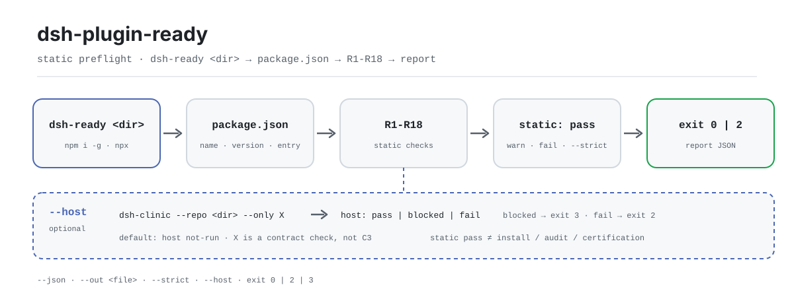

<div align="center">

<picture>
  <source media="(prefers-color-scheme: dark)" srcset="docs/assets/dsh-plugin-ready-flow-dark.svg">
  
</picture>

# dsh-plugin-ready

**装插件之前先验包：一条命令扫完 package.json 的静态入口面，给出人读或机读的 pass / fail 报告。**

`dsh-ready` 是给 DeepSeek Harness 插件作者用的零依赖 CLI——查元数据、入口、`dsh.bundle` 与 patch、`dsh.client`、`engines`、`manifestVersion`、README/LICENSE 和禁用字段；它不安装插件，也不启动宿主。

[安装](#三步上手) · [配置](#配置) · [FAQ](#faq) · [简体中文](README.md) · [English](README.en.md) · [Español](README.es.md) · [Português](README.pt.md) · [हिन्दी](README.hi.md)

[](LICENSE)
[](https://www.npmjs.com/package/dsh-plugin-ready)
[](https://github.com/PerryLink/dsh-plugin-ready/actions/workflows/test.yml)
[](https://nodejs.org/)

[](https://github.com/PerryLink/dsh-plugin-ready/stargazers)
[](https://www.npmjs.com/package/dsh-plugin-ready)
[](https://gitee.com/perrylink/dsh-plugin-ready)

```sh
# 全局安装：npm 包名是 dsh-plugin-ready，装完命令是 dsh-ready
npm i -g dsh-plugin-ready
dsh-ready .

# 免安装运行同一入口
npx dsh-plugin-ready .
```

</div>

<sub>社区工具，与 DeepSeek 官方无关。唯一仓库：<https://github.com/PerryLink/dsh-plugin-ready>（Gitee 为镜像）。不评分、不排名、不构成认证或背书。</sub>

## 它是什么

`dsh-ready` 把「这个插件包能不能被宿主认出来」拆成 18 项静态检查，对着目标目录的 `package.json`、patch 文件与 README/LICENSE 逐条判 pass / warn / fail。默认只汇报、不改任何文件；加 `--json` 得到带 `schema`、`checks`、`notClaimed` 的机读报告，加 `--strict` 让警告也变成失败，适合放进 CI。

它刻意不越界：不安装插件、不启动 DeepSeek Harness、不跑性能测试、不做安全审计、不认证任何东西。需要真实宿主安装证据时，用 `dsh-dev test` 或 `dsh-test-drive` 跑一遍，再把证据交给 `entry-validate --host-evidence`；`--host` 只调用 `dsh-clinic --only X` 做契约检查，输出里明确写着「不是 C3」。

包名与命令名不同：npm 包是 `dsh-plugin-ready`，可执行文件是 `dsh-ready`（见 `package.json#bin`）。没有构建步骤，发布物就是 `bin/` 与 `src/`。

## 三步上手

1. **安装**（Node ≥24.9.0；零运行时依赖）：

   ```sh
   npm i -g dsh-plugin-ready   # 全局安装，提供 dsh-ready
   dsh-ready --version

   npx dsh-plugin-ready --version   # 免安装运行
   ```

2. **快速用法**（默认检查当前目录）：

   ```sh
   dsh-ready                          # 人读报告
   dsh-ready ./my-plugin --json       # 机读 JSON
   dsh-ready ./my-plugin --json --out ready-report.json
   dsh-ready ./my-plugin --strict     # 警告也算失败
   dsh-ready ./my-plugin --host       # 追加 dsh-clinic X（不是 C3）
   ```

3. **验证结果与退出码**：

   ```text
   $ dsh-ready ./my-plugin
   dsh-ready 0.2.3
   target: /path/to/my-plugin
   R1 PASS package.json exists and is valid JSON
   ...
   static: pass-with-warnings (16 pass, 1 warn, 0 fail)
   host: not-run (static preflight only; …)
   ```

   节选；完整字段看 `--json`。`host` 默认为 `not-run`，静态通过不会假装跑过宿主。`$?`：`0` = pass 或 pass-with-warnings；`2` = 有 fail、或被 `--strict` 升级的警告、或 `--host` 为 fail；`3` = 静态层本可返回 `0`、但 `--host` 为 blocked。

   *Observed from `src/ready.js:194-231`；样例来自一份 16 pass / 1 warn 的合法夹具。*

**卸载**：`npm uninstall -g dsh-plugin-ready`（走 `npx` 的话是临时安装，无需卸载）。

## 核心能力

- **18 项静态入口检查** —— 从 `name` / `version` / `description`，到 `exports["."]`、`dsh.bundle` 与 patch 文件、`dsh.client` 和 `exports["./client"]` 的对应关系、`engines` / `manifestVersion`、README/LICENSE 存在性，以及 `dsh.grade` / `score` / `rank` / `level` 这类禁用字段。任一 fail 即整体 fail，warn 默认不拦。
- **人读 + 机读双输出** —— 默认逐行打印 `R<n> PASS|WARN|FAIL` 与详情；`--json` 输出固定 `schema: "dsh-plugin-ready/1"` 的报告，含逐项 `checks`、`static` 汇总与 `notClaimed` 数组。
- **CI 门禁友好** —— 退出码只有 `0` / `2` / `3` 三档；`--strict` 把 warn 升级成 `2`，`--out` 可同时落一份 JSON 产物。
- **可选宿主契约检查** —— `--host` 调用已安装的 `dsh-clinic --only X`，区分 `pass` / `blocked` / `fail`；blocked 明确不算通过（退出码 `3`），也不会替你把 clinic 装上。
- **只读、零依赖** —— 只 import Node 内置模块；除 `--out` 指定的文件外不写盘，不碰目标包的 `package.json`。
- **诚实边界** —— 报告里的 `notClaimed` 固定列出四项不声称：不是宿主安装、不是安全审计、不是性能测量、不是认证或官方背书。

```text
dsh-ready <dir> ──▶ package.json ──▶ R1–R18 ──▶ static: pass | fail ──▶ exit 0 / 2
                                        └── --host ──▶ dsh-clinic X ──▶ pass | blocked | fail
```

## 配置

`dsh-ready` 没有配置文件、没有环境变量、没有隐藏的全局状态；行为只由命令行参数和目标目录决定。最常用的几项：

| 参数 | 默认 | 含义 |
|---|---|---|
| `<dir>` | `.` | 目标插件包目录，内部 `path.resolve` 成绝对路径 |
| `--json` | 关 | 输出机读 JSON 报告到 stdout |
| `--out <file>` | 未设置 | 把 JSON 报告写到文件；与 `--json` 同用时 stdout 仍打印 |
| `--strict` | 关 | 把任何 warn 变成失败（exit 2） |
| `--host` | 关 | 追加 `dsh-clinic --only X` 宿主契约检查（不是 C3） |
| `-h` / `--help` | —— | 打印用法并以 0 退出 |
| `-v` / `--version` | —— | 只打印版本号 |

<details>
<summary>完整检查项（R1–R18）、退出码与报告字段</summary>

### 检查项

| ID | 失败级别 | 检查内容 |
|---|---|---|
| R1 | fail | `package.json` 存在且是合法 JSON |
| R2 | fail | `name` 是非空字符串 |
| R3 | fail | `version` 是合法 semver |
| R4 | warn | `description` 非空 |
| R5 | warn | `license` 非空（合规画像，不是入口硬失败） |
| R6 | fail | `exports["."]`、`main` 至少有一个入口 |
| R7 | fail | `dsh.bundle` 是对象（纯客户端包不算可安装） |
| R8 | fail/warn | `dsh.bundle.patch` 是字符串或字符串数组、文件存在、不是空插入 |
| R9 | fail/warn | 声明 `dsh.client` 时 `exports["./client"]` 必须存在且目标文件存在；缺 `platform` 仅 warn |
| R10 | warn | `engines.dsh` 存在（兼容性画像） |
| R11 | warn | `engines.node` 存在 |
| R12 | warn | `dsh.manifestVersion` 为 `1` |
| R13 | warn | `repository` 存在 |
| R14 | warn | `README.md` 存在 |
| R15 | warn | `LICENSE` 存在 |
| R16 | fail | 不允许 `dsh.grade` / `dsh.score` / `dsh.rank` / `dsh.level` |
| R17 | warn | `dsh.standards.entry.status` 若自报非 `not-run` 状态，只提示、不验证 |
| R18 | warn/pass | `engines.dsh` 与 `peerDependencies["@deepseek-ai/dsh"]` 不一致时 warn；有任一载体时 pass |

### 退出码

| 退出码 | 何时出现 |
|---|---|
| `0` | 静态层 pass 或 pass-with-warnings，且没有被 `--strict` / `--host` 升级 |
| `2` | 任一 fail；或 `--strict` 下有 warn；或 `--host` 为 fail |
| `3` | 静态层本可返回 `0`，但 `--host` 为 blocked（clinic 未安装，或 X 组没跑全） |

### 报告字段

| 字段 | 含义 |
|---|---|
| `schema` | 固定为 `dsh-plugin-ready/1` |
| `tool` / `version` | 工具名与本次运行的版本 |
| `generatedAt` | ISO 时间戳；每次运行都变 |
| `target` | 解析后的目标绝对路径 |
| `package` | 目标包的 `name` / `version`；`package.json` 不可读时为 `null` |
| `static.status` | `pass` / `pass-with-warnings` / `fail` |
| `static.checks[]` | 每条为 `{ id, status, detail }` |
| `host.status` | 默认 `not-run`；`--host` 后为 `pass` / `blocked` / `fail` |
| `host.reason` | 宿主层的人读原因；`--host` 时还带 `command` / `groups` |
| `notClaimed[]` | 固定的四项不声称声明 |

</details>

## FAQ

<details>
<summary>它和真正的插件安装是什么关系？</summary>

没有关系。本工具不执行安装、不解析 profile patch、不启动 DSH，只读目标目录里的静态文件。插件安装是宿主侧的事，本工具既不参与也不代替；要真实宿主安装证据，用 `dsh-dev test` 或 `dsh-test-drive` 跑，再把结果交给 `entry-validate --host-evidence`。

</details>

<details>
<summary>--host 为什么是 blocked，退出码还是 3？</summary>

两种常见原因：PATH 里找不到 `dsh-clinic`（提示 `npm i -g dsh-clinic`），或 clinic 的 X 组没有跑全 / 没输出 JSON。blocked 明确不是 pass，所以单独用退出码 `3` 区分；本工具不会自动安装 clinic。

</details>

<details>
<summary>静态 pass 就等于能发布、能上架或被官方认可吗？</summary>

不是。工具不评分、不排名、不认证，报告里的 `notClaimed` 固定声明四项不声称。它只回答一个问题：宿主在安装或加载插件时最先读取的静态入口面是否齐全。安全、性能、运行时行为、许可证合规都不在这个工具的测量范围内。

</details>

<details>
<summary>它会改我的 package.json，或者顺手帮我修好吗？</summary>

不会。整个检查是只读的，唯一的写盘动作是 `--out` 指定的报告文件。没有 `--fix`、没有 `init`、不会生成建议补丁，也不会改动目标包的任何文件。

</details>

<details>
<summary>为什么对本仓库自己跑会得到 R7 FAIL？</summary>

因为本仓库本身是 CLI 工具包，不是 DSH 插件，没有 `dsh.bundle`。R7 只对插件包有意义——这正是工具的预期边界：它检查的是「插件包装进宿主」所需的字段，不是通用 npm 包卫生。

</details>

<details>
<summary>报告能直接拿去做快照测试吗？</summary>

`generatedAt` 每次运行都不同，逐字节对比前请先剔除该字段；`checks` 的排列也可能随版本调整，建议按 `id` 建映射再比较，而不是按数组下标。

</details>

## 已知限制

- **只做静态预检。** 不安装插件、不启动宿主、不执行插件代码；报告的 `host` 默认为 `not-run`。
- **`--host` 依赖外部 clinic。** 未安装 `dsh-clinic` 或 X 组没跑全时返回 `blocked`（exit 3）；blocked 不是 pass，工具也不会自动补装。
- **`--host` 不是 C3。** X 是宿主契约检查；C3 需要真实宿主安装证据，请用 `dsh-dev test` / `dsh-test-drive`，再交给 `entry-validate --host-evidence`。
- **静态 pass ≠ 审计、认证或评分。** 不检查运行时行为、安全、性能、许可证合规；`notClaimed` 固定声明这些不声称项。
- **R17 只提示不验证。** `dsh.standards.entry.status` 若自报状态，工具不会核对声明是否属实。
- **只面向 DSH 插件包。** 没有 `dsh.bundle` 的普通 npm 包会 R7 FAIL；本仓库自己就是这种 CLI 包，属预期结果。
- **只读、不修复。** 没有 `--fix`，不生成建议补丁，也不改目标 `package.json`。
- **报告非逐字节稳定。** `generatedAt` 每次运行都变；快照对比需先剔除或冻结时钟。

## 开发

```sh
npm install                          # 无运行时依赖；Node >=24.9.0
npm test                             # node --test test/*.test.js
node bin/dsh-ready.js . --json       # 直接跑本仓 CLI
python scripts/gen-readme-assets.py  # 重出两份 hero SVG（Python + Pillow）
```

| 路径 | 作用 |
|---|---|
| `bin/dsh-ready.js` | CLI 入口，把参数转给 `src/ready.js` 的 `main()` |
| `src/ready.js` | `parse` / `check` / `report` / `runHost` / `main`；R1–R18 全在这里 |
| `test/ready.test.js` | 静态检查、`--strict`、R18 的用例 |
| `test/host.test.js` | 用假 `dsh-clinic` 覆盖 `--host` 的用例 |
| `scripts/gen-readme-assets.py` | 生成深浅双版 hero SVG，可重复执行 |
| `docs/assets/` | 生成物：`dsh-plugin-ready-flow-{light,dark}.svg` |
| `.github/workflows/test.yml` | push / PR 跑 `npm test`（Node 20 / 24 矩阵） |
| `.github/workflows/release.yml` | 手动触发，`npm publish --provenance` |

`npm test` 的用例用 `new URL(...).pathname` 拼入口路径，并伪造 POSIX 的 `dsh-clinic` 脚本；在 Windows 本地跑会失败，CI 在 `ubuntu-latest` 上运行。

## 家族与致谢

本项目是 [PerryLink](https://github.com/PerryLink) 维护的 DeepSeek Harness 工具家族成员（全部 Apache-2.0）。同一家族里还有 [dsh-mask](https://github.com/PerryLink/dsh-mask)（模型边界 PII 遮罩）、[dsh-test-drive](https://github.com/PerryLink/dsh-test-drive)（真实宿主安装证据）等工具。

如果这个工具帮你省了一轮装包排错，**给个 star**——它不解锁任何功能，但会让下一个插件作者更容易找到它。

- [@PerryLink](https://github.com/PerryLink) —— 创建者与维护者：R1–R18 检查矩阵、`--host` 契约桥、五语文档。
- [dsh-clinic](https://www.npmjs.com/package/dsh-clinic) —— `--host` 调用的宿主契约检查器。
- [dsh-test-drive](https://github.com/PerryLink/dsh-test-drive) / `dsh-dev test` —— 真实宿主安装证据的来源。

## License

[LICENSE](LICENSE)（Apache License 2.0）© 2026 dsh-plugin-ready contributors

<p align="center"><sub>Apache-2.0 · 社区命令行工具，与 DeepSeek 官方无关。</sub></p>
