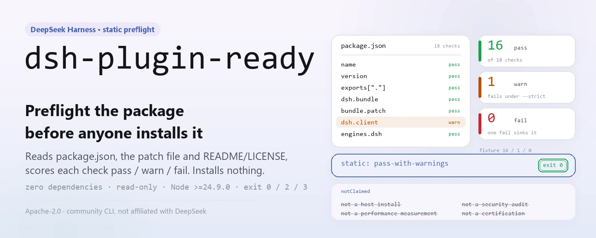
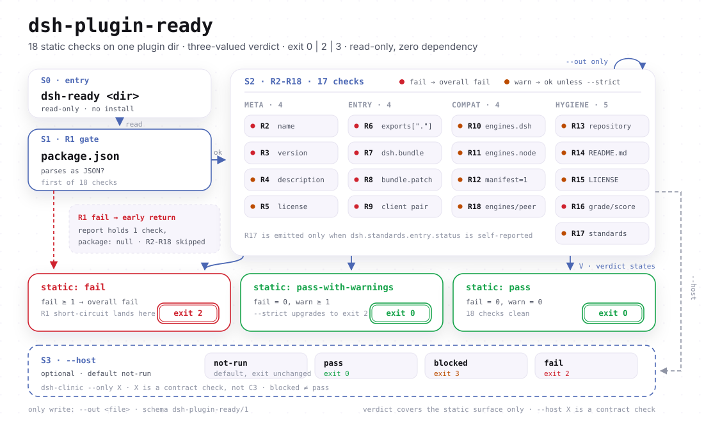

<div align="center">

<picture>
  <source media="(prefers-color-scheme: dark)" srcset="docs/assets/dsh-plugin-ready-hero-en-dark.webp">
  
</picture>

# dsh-plugin-ready

**Valide o pacote antes de instalar o plugin: um comando varre a superfície de entrada estática do package.json e devolve um relatório pass / fail legível por pessoas ou por máquinas.**

`dsh-ready` é uma CLI sem dependências para autores de plugins do DeepSeek Harness. Ela inspeciona metadados, ponto de entrada, `dsh.bundle` e seu patch, `dsh.client`, `engines`, `manifestVersion`, presença de README/LICENSE e campos proibidos. Não instala o plugin nem inicia um host.

[Instalação](#instalação-em-três-passos) · [Configuração](#configuração) · [FAQ](#faq) · [简体中文](README.md) · [English](README.en.md) · [Español](README.es.md) · [Português](README.pt.md) · [हिन्दी](README.hi.md)

[](LICENSE)
[](https://www.npmjs.com/package/dsh-plugin-ready)
[](https://github.com/PerryLink/dsh-plugin-ready/actions/workflows/test.yml)
[](https://nodejs.org/)

[](https://github.com/PerryLink/dsh-plugin-ready/stargazers)
[](https://www.npmjs.com/package/dsh-plugin-ready)
[](https://gitee.com/perrylink/dsh-plugin-ready)

```sh
# instalação global: o pacote npm é dsh-plugin-ready e o comando é dsh-ready
npm i -g dsh-plugin-ready
dsh-ready .

# ou execute o mesmo ponto de entrada sem instalar
npx dsh-plugin-ready .
```

</div>

<sub>Ferramenta comunitária, sem vínculo com a DeepSeek. Repositório canônico: <https://github.com/PerryLink/dsh-plugin-ready> (o Gitee é um espelho). Sem pontuação, ranking, certificação ou endosso.</sub>

## O que é

`dsh-ready` divide a pergunta «o host vai reconhecer este pacote de plugin?» em 18 checagens estáticas sobre o `package.json` do diretório alvo, o arquivo patch e a presença de README/LICENSE. Por padrão apenas relata e nunca edita nada. Com `--json` você recebe um relatório legível por máquina com `schema`, `checks` e `notClaimed`; com `--strict` os avisos também falham, o que o torna utilizável como portão de CI.

Ele fica deliberadamente dentro do seu escopo: não instala o plugin, não inicia o DeepSeek Harness, não mede desempenho, não audita segurança nem certifica nada. Quando precisar de evidência real de instalação em host, rode `dsh-dev test` ou `dsh-test-drive` e entregue a evidência ao `entry-validate --host-evidence`. O `--host` apenas invoca `dsh-clinic --only X` como checagem de contrato, e a saída diz claramente que não é C3.

O nome do pacote e o do comando diferem: o pacote npm é `dsh-plugin-ready` e o executável é `dsh-ready` (ver `package.json#bin`). Não há etapa de build: `bin/` e `src/` são os artefatos publicados.

<picture>
  <source media="(prefers-color-scheme: dark)" srcset="docs/assets/dsh-plugin-ready-flow-v5-dark.svg">
  
</picture>

## Instalação em três passos

1. **Instalar** (Node >= 24.9.0; sem dependências em tempo de execução):

   ```sh
   npm i -g dsh-plugin-ready   # a instalação global fornece dsh-ready
   dsh-ready --version

   npx dsh-plugin-ready --version   # sem instalar
   ```

2. **Uso rápido** (o diretório atual é o alvo padrão):

   ```sh
   dsh-ready                          # relatório legível
   dsh-ready ./my-plugin --json       # JSON para máquinas
   dsh-ready ./my-plugin --json --out ready-report.json
   dsh-ready ./my-plugin --strict     # avisos também falham
   dsh-ready ./my-plugin --host       # adiciona dsh-clinic X (não C3)
   ```

3. **Verificar o resultado e o código de saída**:

   ```text
   $ dsh-ready ./my-plugin
   dsh-ready 0.2.3
   target: /path/to/my-plugin
   R1 PASS package.json exists and is valid JSON
   ...
   static: pass-with-warnings (16 pass, 1 warn, 0 fail)
   host: not-run (static preflight only; ...)
   ```

   Trecho; use `--json` para ver todos os campos. `host` vale `not-run` por padrão, então um pass estático nunca finge que o host rodou. `$?`: `0` = pass ou pass-with-warnings; `2` = alguma falha, um aviso promovido por `--strict` ou um `--host` com falha; `3` = a camada estática retornaria `0`, mas o `--host` está bloqueado.

   *Observed from `src/ready.js:194-231`; amostra de um fixture válido com 16 pass / 1 warn.*

**Desinstalar**: `npm uninstall -g dsh-plugin-ready` (com `npx` a instalação é temporária e não há nada a remover).

## Capacidades principais

- **18 checagens estáticas de entrada** — de `name` / `version` / `description`, passando por `exports["."]`, `dsh.bundle` e seu patch, o par `dsh.client` / `exports["./client"]`, `engines` / `manifestVersion`, presença de README/LICENSE e os campos proibidos `dsh.grade` / `score` / `rank` / `level`. Qualquer falha derruba a execução; avisos não bloqueiam por padrão.
- **Saída para pessoas e para máquinas** — por padrão imprime uma linha `R<n> PASS|WARN|FAIL` por checagem com detalhe; `--json` emite um relatório com `schema: "dsh-plugin-ready/1"`, `checks` por item, resumo `static` e o array `notClaimed`.
- **Amigável a portões de CI** — apenas três códigos de saída: `0` / `2` / `3`. `--strict` transforma avisos em `2` e `--out` grava um artefato JSON além do stdout.
- **Checagem opcional de contrato de host** — `--host` executa o `dsh-clinic --only X` instalado e distingue `pass` / `blocked` / `fail`. Blocked não é pass (código `3`), e a ferramenta nunca instala o clinic por você.
- **Somente leitura e sem dependências** — importa apenas módulos internos do Node. Fora o arquivo indicado por `--out`, não escreve nada e nunca toca no `package.json` alvo.
- **Escopo honesto** — `notClaimed` sempre lista quatro ressalvas: não é instalação em host, não é auditoria de segurança, não é medição de desempenho, não é certificação nem endosso oficial.

```text
dsh-ready <dir> ──▶ package.json ──▶ R1–R18 ──▶ static: pass | fail ──▶ exit 0 / 2
                                        └── --host ──▶ dsh-clinic X ──▶ pass | blocked | fail
```

## Configuração

O `dsh-ready` não tem arquivo de configuração, variáveis de ambiente nem estado global oculto; o comportamento depende apenas dos argumentos da CLI e do diretório alvo. As opções mais usadas:

| Opção | Padrão | Significado |
|---|---|---|
| `<dir>` | `.` | Diretório do pacote alvo, resolvido para caminho absoluto com `path.resolve` |
| `--json` | off | Imprime o relatório JSON legível por máquina no stdout |
| `--out <file>` | não definido | Grava o relatório JSON em um arquivo; com `--json` o stdout continua imprimindo |
| `--strict` | off | Transforma qualquer aviso em falha (exit 2) |
| `--host` | off | Adiciona a checagem de contrato `dsh-clinic --only X` (não C3) |
| `-h` / `--help` | — | Imprime o uso e sai com 0 |
| `-v` / `--version` | — | Imprime apenas a versão |

<details>
<summary>Lista completa de checagens (R1–R18), códigos de saída e campos do relatório</summary>

### Checagens

| ID | Nível de falha | O que verifica |
|---|---|---|
| R1 | fail | `package.json` existe e é JSON válido |
| R2 | fail | `name` é uma string não vazia |
| R3 | fail | `version` é semver válido |
| R4 | warn | `description` não está vazio |
| R5 | warn | `license` não está vazio (perfil legal, não falha dura de entrada) |
| R6 | fail | Pelo menos um ponto de entrada via `exports["."]` ou `main` |
| R7 | fail | `dsh.bundle` é um objeto (pacote só-cliente não é instalável) |
| R8 | fail/warn | `dsh.bundle.patch` é string ou array de strings, o arquivo existe e não é um insert vazio |
| R9 | fail/warn | Com `dsh.client` declarado, `exports["./client"]` deve existir e o arquivo alvo deve existir; falta de `platform` é só aviso |
| R10 | warn | `engines.dsh` existe (perfil de compatibilidade) |
| R11 | warn | `engines.node` existe |
| R12 | warn | `dsh.manifestVersion` é `1` |
| R13 | warn | `repository` existe |
| R14 | warn | `README.md` existe |
| R15 | warn | `LICENSE` existe |
| R16 | fail | `dsh.grade` / `dsh.score` / `dsh.rank` / `dsh.level` são proibidos |
| R17 | warn | Se `dsh.standards.entry.status` declara um status diferente de `not-run`, avisa sem verificar |
| R18 | warn/pass | Avisa quando `engines.dsh` e `peerDependencies["@deepseek-ai/dsh"]` divergem; passa quando existe qualquer um dos dois |

### Códigos de saída

| Código | Quando |
|---|---|
| `0` | A camada estática é pass ou pass-with-warnings e nem `--strict` nem `--host` a elevaram |
| `2` | Qualquer falha; um aviso com `--strict`; ou um `--host` com falha |
| `3` | A camada estática retornaria `0`, mas o `--host` está bloqueado (clinic ausente ou o grupo X não rodou completo) |

### Campos do relatório

| Campo | Significado |
|---|---|
| `schema` | Sempre `dsh-plugin-ready/1` |
| `tool` / `version` | Nome da ferramenta e versão que produziu a execução |
| `generatedAt` | Carimbo ISO; muda a cada execução |
| `target` | Caminho absoluto resolvido do alvo |
| `package` | `name` / `version` do alvo; `null` quando `package.json` não pode ser lido |
| `static.status` | `pass` / `pass-with-warnings` / `fail` |
| `static.checks[]` | Um `{ id, status, detail }` por checagem avaliada |
| `host.status` | `not-run` por padrão; `pass` / `blocked` / `fail` após `--host` |
| `host.reason` | Motivo legível; execuções com `--host` também trazem `command` / `groups` |
| `notClaimed[]` | As quatro ressalvas fixas |

</details>

## FAQ

<details>
<summary>Qual é a relação com a instalação real de um plugin?</summary>

Nenhuma. Esta ferramenta não instala nada, não interpreta o patch do perfil e não inicia o DSH; apenas lê arquivos estáticos do diretório alvo. Instalar plugins é tarefa do host, e esta ferramenta nem faz isso nem substitui. Para evidência real de instalação em host, rode `dsh-dev test` ou `dsh-test-drive` e entregue o resultado ao `entry-validate --host-evidence`.

</details>

<details>
<summary>Por que o --host aparece bloqueado e com código de saída 3?</summary>

Duas causas comuns: o `dsh-clinic` não está no PATH (o relatório sugere `npm i -g dsh-clinic`) ou o grupo X não rodou completo / não produziu JSON. Blocked não é pass, por isso ganha o código `3`. A ferramenta nunca instala o clinic automaticamente.

</details>

<details>
<summary>Um pass estático significa que o pacote pode ser publicado, listado ou reconhecido oficialmente?</summary>

Não. A ferramenta não pontua, não faz ranking nem certifica, e o `notClaimed` sempre declara as quatro coisas que ela não afirma. Ela responde apenas uma pergunta: a superfície de entrada estática que o host lê primeiro está completa? Segurança, desempenho, comportamento em execução e conformidade de licença ficam fora do escopo.

</details>

<details>
<summary>Ele vai modificar meu package.json ou corrigir os problemas por mim?</summary>

Não. Toda a checagem é somente leitura; a única escrita é o arquivo de relatório indicado por `--out`. Não existe `--fix`, nem `init`, nem patch sugerido, nem alteração em qualquer arquivo do pacote alvo.

</details>

<details>
<summary>Por que rodar neste próprio repositório dá R7 FAIL?</summary>

Porque este repositório é um pacote CLI, não um plugin do DSH, e portanto não tem `dsh.bundle`. O R7 só faz sentido para pacotes de plugin: esse é exatamente o limite da ferramenta, que verifica o necessário para «instalar um pacote de plugin», não a higiene geral de um pacote npm.

</details>

<details>
<summary>O relatório pode ser usado direto em testes de snapshot?</summary>

`generatedAt` muda a cada execução, então remova o campo antes de comparar byte a byte. A ordem de `checks` também pode mudar entre versões; compare com um mapa indexado por `id`, não pela posição no array.

</details>

## Limitações conhecidas

- **Somente preflight estático.** Não instala o plugin, não inicia um host nem executa código do plugin; `host` vale `not-run` por padrão.
- **`--host` depende de um clinic externo.** Sem o `dsh-clinic`, ou se o grupo X não rodar completo, o resultado é `blocked` (exit 3). Blocked não é pass e a ferramenta não instala o clinic por você.
- **`--host` não é C3.** X é uma checagem de contrato de host. C3 exige evidência real de instalação em host com `dsh-dev test` / `dsh-test-drive`, entregue ao `entry-validate --host-evidence`.
- **Pass estático não é auditoria, certificação nem pontuação.** Comportamento em execução, segurança, desempenho e conformidade de licença não são verificados; o `notClaimed` declara isso explicitamente.
- **R17 informa sem verificar.** Se `dsh.standards.entry.status` declara um status, a ferramenta não confirma se é verdade.
- **Somente pacotes de plugin do DSH.** Um pacote npm comum sem `dsh.bundle` falha no R7; este repositório é exatamente um pacote CLI assim, então essa falha é esperada.
- **Somente leitura, sem reparo.** Não há `--fix`, nem patch sugerido, nem reescrita do `package.json` alvo.
- **O relatório não é estável byte a byte.** `generatedAt` muda a cada execução; congele o relógio ou remova o campo antes de comparar snapshots.

## Desenvolvimento

```sh
npm install                          # sem dependências de execução; Node >= 24.9.0
npm test                             # node --test test/*.test.js
node bin/dsh-ready.js . --json       # executar a CLI deste repositório
python scripts/gen-readme-assets.py  # regerar os hero WebP e os SVG do fluxo (Python + Pillow)
```

| Caminho | Propósito |
|---|---|
| `bin/dsh-ready.js` | Entrada da CLI; encaminha os argumentos para `main()` em `src/ready.js` |
| `src/ready.js` | `parse` / `check` / `report` / `runHost` / `main`; R1–R18 vive aqui |
| `test/ready.test.js` | Casos de checagem estática, `--strict` e R18 |
| `test/host.test.js` | Casos de `--host` contra um `dsh-clinic` falso |
| `scripts/gen-readme-assets.py` | Gera os hero WebP e os SVG do fluxo; repetível |
| `docs/assets/` | Saída: `dsh-plugin-ready-hero-{zh,en}-{light,dark}.webp`, `dsh-plugin-ready-flow-v5-{light,dark}.svg` |
| `.github/workflows/test.yml` | Roda `npm test` em push / PR (matriz Node 20 / 24) |
| `.github/workflows/release.yml` | Disparo manual; `npm publish --provenance` |

Os testes montam o caminho de entrada com `new URL(...).pathname` e simulam um script `dsh-clinic` POSIX, então `npm test` falha em um shell Windows local; a CI roda em `ubuntu-latest`.

## Família e agradecimentos

Este projeto é membro da família de ferramentas do DeepSeek Harness mantida pela [PerryLink](https://github.com/PerryLink) (todas Apache-2.0). Entre as ferramentas irmãs estão o [dsh-mask](https://github.com/PerryLink/dsh-mask) (mascaramento de PII na fronteira do modelo) e o [dsh-test-drive](https://github.com/PerryLink/dsh-test-drive) (evidência real de instalação em host).

Se esta ferramenta economiza uma rodada de depuração na instalação, **deixe uma estrela**: ela não desbloqueia nada, mas ajuda o próximo autor de plugins a encontrá-la.

- [@PerryLink](https://github.com/PerryLink) — criador e mantenedor: a matriz de checagens R1–R18, a ponte de contrato `--host` e a documentação em cinco idiomas.
- [dsh-clinic](https://www.npmjs.com/package/dsh-clinic) — o verificador de contrato de host invocado pelo `--host`.
- [dsh-test-drive](https://github.com/PerryLink/dsh-test-drive) / `dsh-dev test` — de onde vem a evidência real de instalação em host.

## Licença

[LICENSE](LICENSE) (Apache License 2.0) © 2026 dsh-plugin-ready contributors

<p align="center"><sub>Apache-2.0 · ferramenta de linha de comando comunitária, sem vínculo com a DeepSeek.</sub></p>
